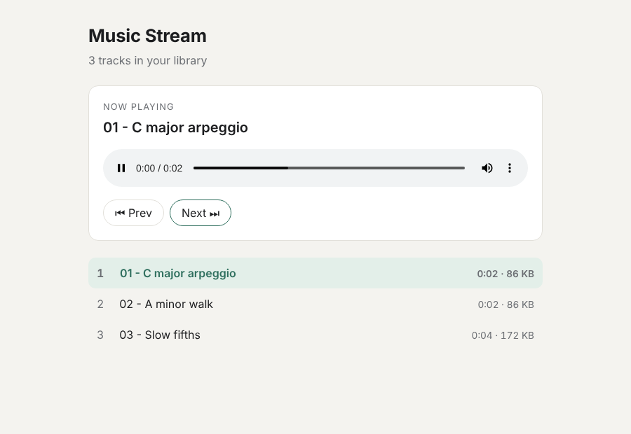

# online-music-stream-with-python

A small, self-hosted **music streaming server** written with nothing but the **Python standard
library**. Point it at a folder of audio files and open the browser: you get a clean HTML5
player with a playlist, next/previous buttons and working **seeking** thanks to HTTP Range
requests.



## Why

- Listen to your own music collection from any device on your network without installing a
  media server.
- No dependencies: runs anywhere Python 3.10+ runs (`http.server.ThreadingHTTPServer`).
- A compact, readable example of byte-range streaming and safe static file serving.

## Features

- `GET /` — responsive player page (light/dark via `prefers-color-scheme`), playlist,
  prev/next, auto-advance to the next track.
- `GET /api/tracks` — JSON list of tracks: title, relative path, file name, size, MIME type,
  stream URL and duration (read with the `wave` module for WAV files; `null` for other formats).
- `GET /media/<path>` — streams a file with `Accept-Ranges: bytes`; honours `Range` headers
  (`bytes=a-b`, `bytes=a-`, `bytes=-n`) with **206 Partial Content**, answers
  **416** for unsatisfiable ranges, supports `HEAD`, sends files in 64 KiB chunks.
- **Path traversal protection**: `..`, encoded `%2e%2e`, absolute paths, backslashes, NUL bytes,
  hidden files and symlinks that point outside the library all return 404.
- Recursive library scan; supported extensions: `.mp3 .wav .ogg .oga .opus .flac .m4a .aac .webm`.
- Binds to `127.0.0.1` by default.

## Install

```bash
git clone https://github.com/ariaesm/online-music-stream-with-python.git
cd online-music-stream-with-python
```

There is nothing to `pip install` for running the server (`requirements.txt` is intentionally
empty). Tests need `pytest`.

## Usage

Create a few demo tracks (generated sine-tone melodies) or use your own folder:

```text
$ python3 -m musicstream.demo music
wrote music/01 - C major arpeggio.wav
wrote music/02 - A minor walk.wav
wrote music/03 - Slow fifths.wav

$ python3 -m musicstream music --port 8000
Serving 3 track(s) from /path/to/online-music-stream-with-python/music at http://127.0.0.1:8000/
```

Open <http://127.0.0.1:8000/>. To reach it from other devices on your LAN use
`--host 0.0.0.0` (there is no authentication, so only do this on a trusted network).
`-q` disables request logging.

API examples (real output from a local run):

```text
$ curl -s http://127.0.0.1:8000/api/tracks
{"count": 3, "tracks": [{"id": 0, "title": "01 - C major arpeggio",
  "path": "01 - C major arpeggio.wav", "filename": "01 - C major arpeggio.wav",
  "size": 88244, "duration": 2.0, "mime": "audio/wav",
  "url": "/media/01%20-%20C%20major%20arpeggio.wav"}, ...]}

$ curl -s -D - -o /dev/null -H 'Range: bytes=0-1023' \
    "http://127.0.0.1:8000/media/01%20-%20C%20major%20arpeggio.wav"
HTTP/1.1 206 Partial Content
Server: musicstream/0.1 Python/3.13.18
Content-Range: bytes 0-1023/88244
Content-Type: audio/wav
Content-Length: 1024
Accept-Ranges: bytes
X-Content-Type-Options: nosniff
Referrer-Policy: no-referrer

$ curl -s -o /dev/null -w '%{http_code}\n' "http://127.0.0.1:8000/media/%2e%2e/README.md"
404
```

(Captured on a different local port; the JSON is re-wrapped for readability and the `Date` header is omitted.)

## Project layout

```
musicstream/
  server.py        request handler, routing, Range streaming, CLI
  ranges.py        Range header parser
  library.py       safe path join, library scan, WAV duration
  demo.py          generates demo WAV files with the stdlib
  static/index.html  player page (vanilla JS, no build step)
tests/test_musicstream.py
```

## Tests

```bash
python3 -m pip install pytest
python3 -m pytest
```

46 tests: Range parsing (valid, ignored and unsatisfiable headers), path safety (traversal,
absolute, hidden, NUL, backslash, symlink escape), library scan and metadata, and a live server
started on a random port that checks the player page, `/api/tracks`, full downloads,
206 responses byte-for-byte, 416, `HEAD` and traversal attempts over real HTTP.
CI runs `ruff` and `pytest` on Python 3.12.

## Limitations

- Duration is only read for WAV files (no ID3/FLAC tag parsing without extra libraries).
- Multi-range requests (`bytes=0-1,5-6`) are answered with the full file, which RFC 9110 allows.
- No authentication or HTTPS; put it behind a reverse proxy if you expose it beyond your LAN.

## License

[Apache License 2.0](LICENSE)
